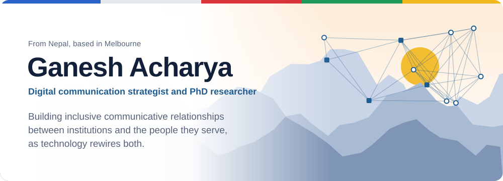
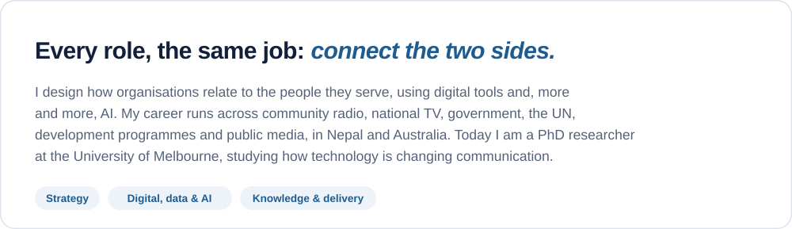
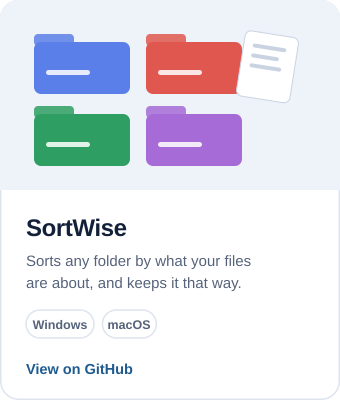
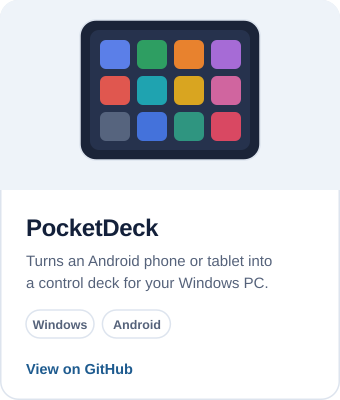
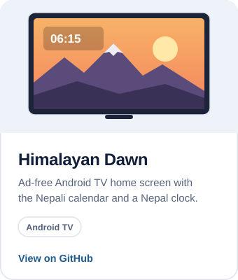

<a href="https://gacharya.com/">
<picture>
  <source media="(prefers-color-scheme: dark)" srcset="assets/hero-dark.svg">
  
</picture>
</a>

  <a href="https://gacharya.com/"><picture><source media="(prefers-color-scheme: dark)" srcset="assets/btn-web-dark.svg"></picture></a>&nbsp;
  <a href="https://www.linkedin.com/in/theganeshlife"><picture><source media="(prefers-color-scheme: dark)" srcset="assets/btn-in-dark.svg"></picture></a>&nbsp;
  <a href="https://buymemomo.com/gacharya"><picture><source media="(prefers-color-scheme: dark)" srcset="assets/btn-momo-dark.svg"></picture></a>

 

<picture>
  <source media="(prefers-color-scheme: dark)" srcset="assets/h-about-dark.svg">
  
</picture>

<a href="https://gacharya.com/story">
<picture>
  <source media="(prefers-color-scheme: dark)" srcset="assets/about-dark.svg">
  
</picture>
</a>

  

<picture>
  <source media="(prefers-color-scheme: dark)" srcset="assets/h-build-dark.svg">
  
</picture>

<!-- cards:start -->

  <a href="https://github.com/theganeshlife/SortWise"><picture><source media="(prefers-color-scheme: dark)" srcset="assets/card-sortwise-dark.svg"></picture></a>
  <a href="https://github.com/theganeshlife/pocketdeck"><picture><source media="(prefers-color-scheme: dark)" srcset="assets/card-pocketdeck-dark.svg"></picture></a>
  <a href="https://github.com/theganeshlife/himalayan-dawn"><picture><source media="(prefers-color-scheme: dark)" srcset="assets/card-dawn-dark.svg"></picture></a>

<!-- cards:end -->

 

<a href="https://gacharya.com/contact">
<picture>
  <source media="(prefers-color-scheme: dark)" srcset="assets/footer-dark.svg">
  
</picture>
</a>
